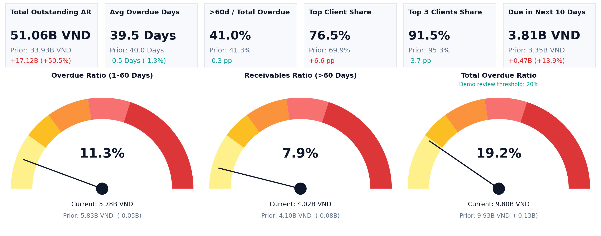
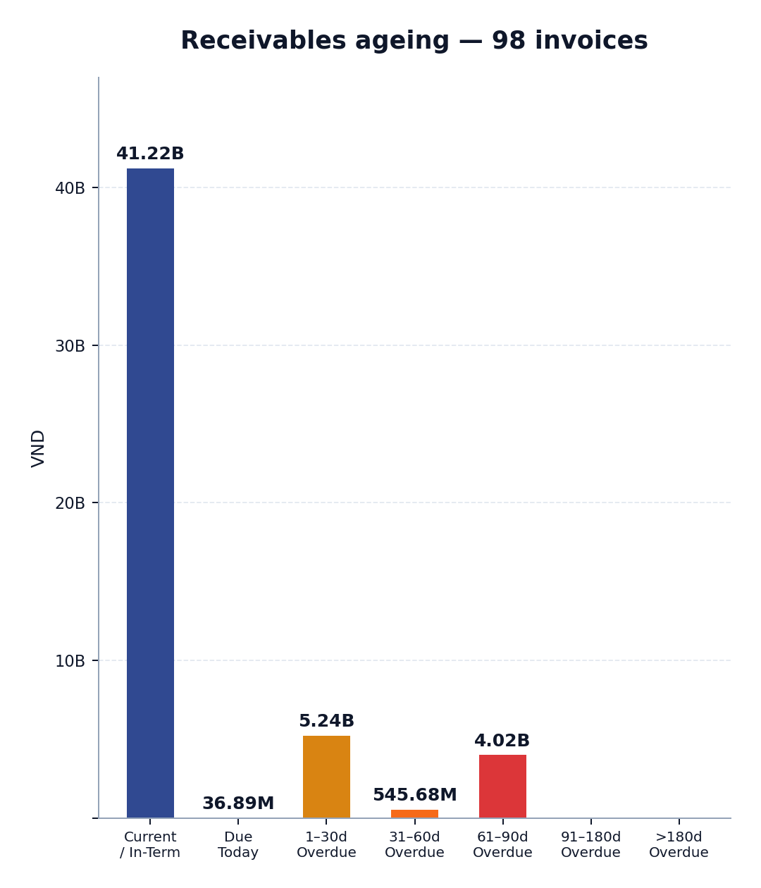
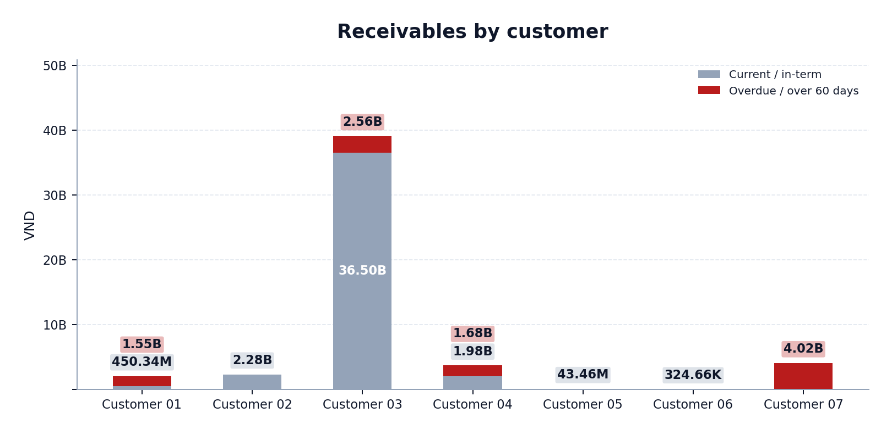
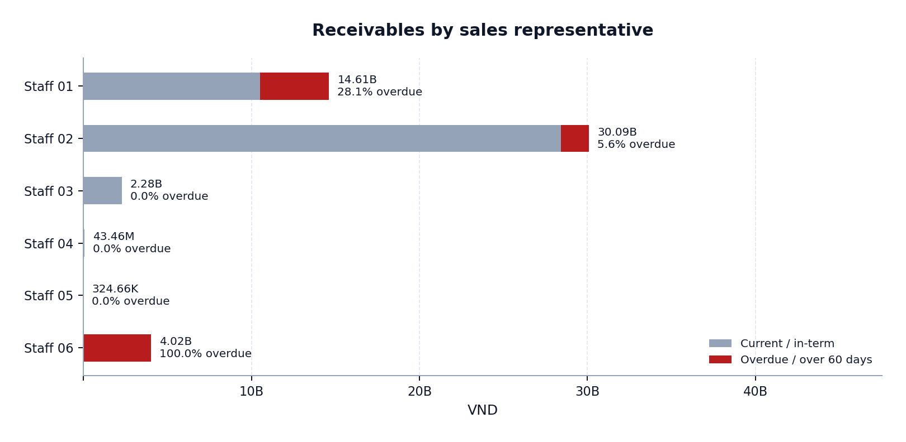

# Accounts receivable intelligence

## The project

I conceived and built this dashboard on my own initiative, without a request or predefined brief from the owner. The previous emailed report summarised outstanding, due and overdue balances by customer. It did not include ageing analysis, period comparisons or a view of collection responsibility.

The Excel dashboard added those views and customer, staff and status filters. Seeing the dashboard helped the owner recognise its usefulness for collection follow-up. Excel was chosen because the team already used it and could inspect and share the workbook through its existing reporting process.

## Owner feedback

> “Thanks em. It is the comprehensive report and then easy to see who I shall remind in collection.”

Company owner, following adoption of the reporting workflow. This is qualitative feedback, not a measured cash-collection improvement or time saving.

## Explore the public example

- [Open the case study](https://ntxhien25.github.io/ar-reconciliation.html).
- [Download the Excel workbook](AR_Intelligence_Reconciliation_DEMO.xlsx).
- Review the dashboard, then use its customer, staff and status filters to explore collection priorities.
- Inspect the current and prior invoice schedules, calculations and collection-follow-up views supporting the dashboard.
- The workbook retains six KPI cards, three native Excel gauges, customer/staff charts and six reconciliation checks on its Checks sheet.

## What the public data represents

The story and owner feedback relate to my actual work. The workbook contains 98 fictional current invoices and 80 fictional prior invoices. Invoice details are fictional; aggregate balances and customer, staff and ageing proportions retain the earlier public presentation. The displayed amounts are not presented as actual client balances or measured business results.

The 20% review threshold is illustrative, not a company credit policy. The workbook demonstrates the reporting method and has no connection to a live ERP. This repository contains the public workbook and chart images, not original business records.

## Workbook guide

| Sheet | What to explore |
| --- | --- |
| Dashboard | KPI cards, gauges, customer/staff charts and filters |
| Current AR | Current fictional invoice records |
| Prior AR | Prior-period fictional records for comparison |
| Analysis | Calculations supporting the dashboard |
| Collection Follow-up | Invoice-level collection review |
| Checks | Reconciliation checks supporting the workbook |

## Dashboard gallery

### Executive overview

### Ageing analysis

### Customer balances

### Staff portfolios

## Included files

- [Excel demonstration](AR_Intelligence_Reconciliation_DEMO.xlsx): the complete public workbook, including formulas and native charts.
- `charts/`: the four visuals above, matching the case study.
- `README.md`: project story, owner feedback, exploration guide and data scope.

The website case study remains at [AR showcase](https://ntxhien25.github.io/ar-reconciliation.html). This folder intentionally contains only the public AR demonstration. Original client records, unrelated projects and private review materials are excluded.
